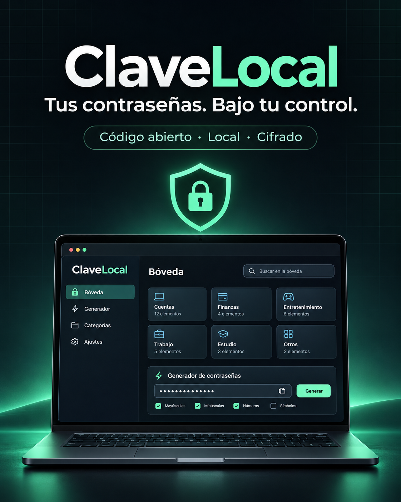

# ClaveLocal 🔐

**Generador y bóveda de contraseñas local, privada y de código abierto.**



ClaveLocal nace de una idea sencilla: una herramienta de contraseñas debería ser útil sin obligarte a crear una cuenta ni enviar tus datos a un servidor. La bóveda se cifra en tu navegador y permanece en tu computadora.

> [!IMPORTANT]
> ClaveLocal está en una etapa inicial y todavía no ha recibido una auditoría independiente. Es un proyecto educativo y comunitario; para secretos críticos, utiliza un gestor de contraseñas con auditorías públicas y trayectoria comprobada.

## Funciones actuales

- Perfil local: usuario y clave maestra al crear; bienvenida personalizada y solo clave al volver. Edición desde **Mi perfil**.
- Generador de contraseñas basado en `crypto.getRandomValues`.
- Bóveda cifrada con AES-256-GCM.
- Derivación de clave con PBKDF2-SHA-256 y 600.000 iteraciones; migración de bóvedas antiguas después de autenticarlas.
- Búsqueda, categorías y favoritos.
- Listas de 10 entradas por página, con Anterior/Siguiente y búsqueda sobre todos los resultados de la categoría seleccionada.
- Copia rápida y limpieza del portapapeles después de 30 segundos cuando el navegador lo permite.
- Bloqueo automático: 5 minutos sin actividad e inmediato al ocultar por defecto; desde Ajustes de bloqueo se pueden elegir otros plazos.
- Exportación e importación de copias cifradas.
- Importación CSV de Chrome y Brave con resumen y detección de duplicados exactos; añade entradas sin reemplazar la bóveda.
- Búsqueda manual de actualizaciones firmadas desde el escritorio, con confirmación antes de instalar.
- Sin telemetría, cuentas, anuncios ni conexiones de red de la bóveda. La versión de escritorio incorpora Tauri y WebView2.

## Inicio rápido en Windows

### Probar sin instalar

Abre [la demo pública](https://josuaperez.github.io/clavelocal/). Incluye datos ficticios; no permite guardar ni importar contraseñas reales.

### Descargar la aplicación

1. Abre [las versiones publicadas](https://github.com/JosuaPerez/clavelocal/releases).
2. Descarga el instalador `.exe` de Windows, instálalo para tu usuario y abre ClaveLocal. No necesitas Node.js ni Git.
3. Crea una clave maestra larga y única y exporta tu copia cifrada.

La versión 0.3 es experimental. Todavía no hay firma de editor Authenticode: Windows puede mostrar una advertencia. No desactives las protecciones del sistema para instalarlo. La firma de las actualizaciones se verifica dentro de la app, pero es distinta de la identidad de editor que comprueba Windows.

Si tienes 0.2, exporta una copia cifrada, cierra ClaveLocal e instala 0.3 manualmente una vez, con el mismo usuario de Windows, sin borrar datos. Desde 0.3 aparece **Buscar actualizaciones**. Solo los releases publicados se ofrecen como actualizaciones; subir un commit no actualiza las instalaciones.

## Importar desde Chrome o Brave

1. Crea o abre tu bóveda y pulsa **Importar contraseñas CSV**.
2. Selecciona el CSV exportado por el navegador. Se reconocen `name`, `url`, `username`, `password` y `note`/`notes`, y puedes ajustar el mapeo.
3. Revisa el número de entradas nuevas, duplicados exactos y registros inválidos; confirma la importación. Verifica después tus entradas y exporta una copia cifrada.

El archivo se procesa en este equipo, sin enviarlo a servidores. El CSV original sigue conteniendo contraseñas sin cifrar: elimínalo tú de forma segura cuando termines de comprobar la migración. La app no lo borra ni lo modifica. Se admiten CSV UTF-8 con comas, punto y coma o tabuladores; tamaño máximo 4 MiB y hasta 5.000 entradas totales. Los valores demasiado largos se señalan como inválidos, sin truncarlos. El botón **Restaurar copia JSON** es un flujo diferente que reemplaza la bóveda completa tras verificarla.

Consulta [las actualizaciones](docs/UPDATES.md) y [la firma de Windows](docs/WINDOWS_SIGNING.md).

Desde 0.3.2, la pantalla de acceso muestra el botón de entrada y una demo discreta debajo. Para restaurar una copia o descargar la copia anterior sin abrir la bóveda, utiliza **Ayuda**, en la barra superior. La restauración JSON también permanece disponible dentro de la bóveda.

La bóveda de escritorio se guarda cifrada en los datos de WebView2 de tu usuario. Es independiente de la del navegador: para migrar desde 0.1, exporta la copia desde el navegador y restáurala en la app. Conserva esa copia hasta verificar tus entradas.

## Ejecutar desde el código fuente

Requisitos: [Node.js](https://nodejs.org/) 20 o posterior.

1. Descarga o clona este repositorio.
2. Haz doble clic en `Abrir ClaveLocal.bat`.
3. Crea una clave maestra de al menos 12 caracteres.
4. Mantén abierta la ventana de ClaveLocal mientras utilizas la aplicación.

También puedes iniciarla desde una terminal:

```powershell
npm start
```

La aplicación estará disponible únicamente en `http://127.0.0.1:4173`.

## Cómo protege los datos

```text
Clave maestra
    │
    ├─ PBKDF2-SHA-256 + salt aleatorio ──► clave AES-256
    │
    └─ AES-256-GCM + IV aleatorio ───────► bóveda cifrada en el navegador
```

La clave maestra no se guarda. Las entradas solo están descifradas en memoria mientras la bóveda permanece abierta. El archivo de bóveda contiene el salt, los parámetros criptográficos y el texto cifrado autenticado.
El nombre de usuario se recuerda también como dato visible para mostrar la bienvenida antes de abrir la bóveda; nunca sirve para descifrarla. Consulta [el perfil local](docs/LOCAL_PROFILE.md). Windows Hello y passkeys son trabajo futuro, todavía no disponible.

## Desarrollo

La app web no carga librerías remotas. Para construir el instalador se necesitan las herramientas de desarrollo de Tauri, Rust y C++ de Windows.

```powershell
npm test
npm run test:e2e
npm run build
npm start
```

Antes de proponer cambios, consulta [CONTRIBUTING.md](CONTRIBUTING.md), [SECURITY.md](SECURITY.md) y la [hoja de ruta](docs/ROADMAP.md).

`npm run desktop:build` genera el instalador. Las pruebas de navegador requieren `npx playwright install chromium`. `npm run build` separa la aplicación real (`dist/`) de la web pública de demostración (`site/`); solo esta última se despliega en GitHub Pages.

## Principios del proyecto

1. **Local primero:** la red no debe ser necesaria para usar la bóveda.
2. **Privacidad verificable:** sin telemetría ni recopilación silenciosa.
3. **Seguridad comprensible:** decisiones documentadas y código fácil de revisar.
4. **Evolución abierta:** las mejoras se discuten mediante issues y pull requests.

## Licencia

MIT © 2026 Josua Perez. Consulta [LICENSE](LICENSE).
